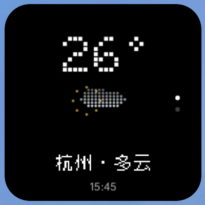

# 点阵天气

纯 Java / 原生 RemoteViews 的两页方形 Android 天气组件。设计参考 Nothing KDE Widgets 的方形构图，采用本工作区 14dp 圆角、纯黑底、Doto 700 和 3×5 桌面对齐规则。图标由本项目以几何点阵绘制。



- 首页：当前温度、放大的日夜天气动画、“城市 · 天气”单行状态与天气数据时间。
- 第二页：最高/最低温度、US AQI、未来约3小时最高小时降雨概率、体感。
- 右侧 48dp 热区切页，主体打开详情与城市搜索；页码点短暂高亮300ms。
- 每个桌面实例独立保存城市、坐标、天气缓存、加载/错误状态和页码；点击哪个组件，就只配置该实例。手动城市配置，无 GPS、Root、前台服务或第三方依赖。
- JobScheduler 非精确30分钟更新，联网时请求、离线时更新缓存状态；删除最后实例取消任务。手动刷新可能受系统调度延迟。
- 网络失败保留缓存并标 STALE；天气获取/数据时间超过90分钟也标 STALE。空气数据超过3小时隐藏，缺失显示 --。
- API 天气是模型结果，空气为 CAMS 模型估算；US AQI 并非中国 AQI。数据时间与手机时钟分别处理。
- 切页和数据刷新后播放约1.5秒的信息动画：天气粒子、真实风向流动、温度趋势呼吸及AQI边缘灯；随后恢复静态，不常驻高频刷新。
- 天气色彩：晴日高亮黄、雾灰蓝、雨蓝、雪白、雷电黄；夜间晴天显示冷白月牙。
- Doto 不含中文字符；首页中文状态行使用与 FM 组件一致的 Zpix 最像素字体，Doto 继续负责英文、数字和温度。

## 构建与安装

工具：JDK 17、Android SDK 34、Build Tools 34.0.0。compile API34 / min API24 / target API31。

```sh
sh build.sh
adb install -r build/weather-widget.apk
```

打开点阵天气，搜索城市或选择杭州，再手动添加1×1“点阵天气”。其他网格保证等比内容，卡片正方形校正以一加7T Pro / OPlus 3×5为准。构建中间目录在 build/run.*，仅用于复现调试，可以删除；build/debug.keystore 是后续覆盖安装的签名，须保留并备份，不上传 GitHub。

源码职责：WeatherWidget 生命周期/热区/调度；WeatherRenderer 排版和原创图标；WeatherStore 按 `appWidgetId` 隔离配置与缓存；WeatherSource 有限响应HTTPS网络/解析；WeatherJob 依次更新所有已配置实例；WeatherActivity 编辑被点击的组件。

权限：INTERNET 获取天气和城市；ACCESS_NETWORK_STATE 调度联网任务；RECEIVE_BOOT_COMPLETED 恢复调度。JobService 仅系统凭 BIND_JOB_SERVICE 权限可调用。

数据归属：Open-Meteo https://open-meteo.com/ 、CAMS https://atmosphere.copernicus.eu/ （CC BY 4.0，详见官方条款）。英数采用 Doto（SIL OFL，许可证随包附带）；中文采用开源字体 [Zpix 最像素](https://github.com/SolidZORO/zpix-pixel-font)。
设计参考：https://github.com/jaxparrow07/nothing-kde-widgets ，未复制其字体或图标资源。

默认发布APK为自用debug签名。卸载：adb uninstall com.unimend.weather（会清除配置缓存）。
